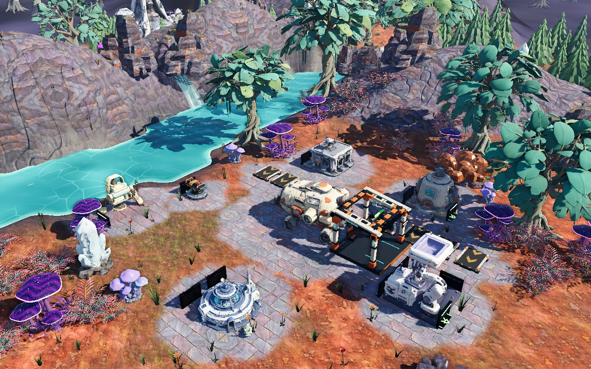

# Frontier Corp

Одиночная 3D-игра о строительстве фабрики на чужой планете. Колония начинает у разбитого корабля. Завод производит материалы, грузовые дроны связывают удалённые площадки, а восстановленный орбитальный лифт принимает поставки.



На новом старте к западу от разбитого корабля проходит река с водопадом, к северу поднимается базальтовая гряда. За пределами плит растут коралловые папоротники и фиолетовые светогрибы. У медной и железной жил свой цвет и локальный источник света. Колония на первом кадре построена после высадки.

[Место высадки до строительства](previews/landing.jpg) · [Медь в сумерках](previews/copper.jpg) · [Кристальная пещера](previews/cavern.jpg)

## Запуск на Windows 10 или 11, x64

1. Скачайте папку [Windows](Windows) целиком. На GitHub можно выбрать **Code → Download ZIP** на странице репозитория и распаковать его. Для выборочной загрузки через Git используйте команды ниже.
2. В папке Windows должны лежать все пронумерованные части, Install.cmd и SHA256.txt. Дважды щёлкните **Install.cmd**. Установщик соберёт ZIP, проверит SHA-256 и распакует игру в новую папку FrontierCorp-Windows. Для распаковки нужно около 3 ГБ свободного места.
3. Запустите **FrontierCorp.exe**. Выберите «Новая игра». Для настройки цен, рецептов, зданий и исследований запустите **FrontierEditor.exe**. Оба приложения можно запускать без интернета.
4. В редакторе выберите раздел проекта, сохраните пресет и примените его к папке игры. При повторном применении редактор создаёт резервную копию рядом с balance.frontier.json. Перезапустите игру, чтобы прочитать новые значения.

Для загрузки только Windows-сборки с помощью Git выполните команды в свободной папке.

```sh
git clone --depth 1 --filter=blob:none --sparse https://github.com/aloverdoz/ProjectAloverdoz.git
cd ProjectAloverdoz
git sparse-checkout set FrontierCorp/Windows
```

При ручной распаковке объедините части в порядке номеров, откройте получившийся ZIP и распакуйте FrontierCorp.exe. Создайте рядом копию с именем FrontierEditor.exe. Имя файла выбирает стартовый экран. Контрольные суммы приведены в [SHA256.txt](Windows/SHA256.txt).

## Управление и первые постройки

- Новая игра по умолчанию открывается в режиме стратегии. WASD перемещает камеру, колесо меняет дистанцию. Щелчок по сооружению открывает его окно.
- F6 переключает стратегию, вид от третьего и вид от первого лица. В личном режиме WASD перемещает персонажа. При возвращении из стратегии персонаж появляется в том месте, где вы его оставили.
- Начните со стартовой руды возле корабля. Подключите бур и плавильню к энергосети и соедините выход с входом конвейером. Доступные технологии открывают новые рецепты и типы месторождений.
- Присвойте двум грузовым площадкам один канал. На отправляющей площадке выберите изготовленных в мастерской дронов, на принимающей выведите груз на ленты. Дополнительных дронов можно отозвать после рейса.
- Войдите через пещерную арку. Внутри WASD и мышь отвечают за движение и обзор, E забирает находку, Esc возвращает на поверхность. В горячем разломе F даёт вспышку фонаря рядом со стражем.
- При переносе предмета на панель быстрого доступа создаётся привязка к предмету. Содержимое рюкзака остаётся на месте.

## Проверка производительности

Файл Windows/Benchmark.cmd запускает отдельную тестовую колонию на среднем профиле. После выхода из игры в папке Windows появится FrontierCorp-benchmark.log. В строке PERF указаны среднее и худшее время кадра, число построек, противников, вызовов отрисовки и примитивов. Профиль нагрузки сильно плотнее стартовой карты.

Если драйвер не поддерживает Vulkan, можно открыть командную строку в папке с распакованной игрой и выполнить `FrontierCorp.exe --rendering-method gl_compatibility`.

## Исходники и модели

Откройте [project.godot](project.godot) в стандартном Godot 4.6.3. После первого импорта нажмите F5. Исходная сцена меню находится в scenes/menu.tscn. Пресет экспорта «Frontier Corp Windows x64» собирает комплект для Windows. Для экспорта установите шаблоны Godot той же версии.

Каталог art/colony содержит оптимизированные пользовательские GLB и индексы для дальних уровней детализации. Турель и прямой модуль конвейера лежат в [art/designed](art/designed). Рабочие прямые секции, углы и варианты скоростей лент собираются из данных core/models.json. Blender-исходники в виде генераторов находятся в tools/art.

[Аудит геометрии и анимаций](docs/Модели.csv) · [Турель крупно](previews/turret.jpg) · [Конвейер крупно](previews/belt.jpg) · [Сравнение корабля до и после оптимизации](previews/wreck-comparison.jpg)
