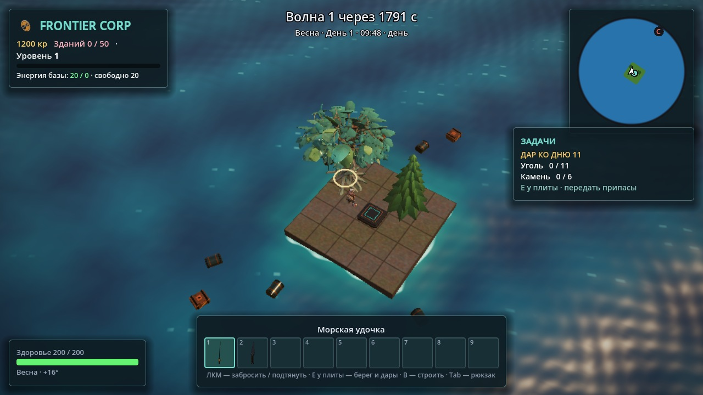

# Frontier Corp · Остров

Вы начинаете на 25 клетках посреди океана. На берегу растут два дерева, в центре лежит древняя плита. С помощью удочки собирайте материалы, насыпайте сушу и стройте фабрику.

## Скачать для Windows x64

Скачайте и распакуйте один архив. Запустите **FrontierCorp.exe**, выберите **Новая игра → Океан · остров 5×5**. Чтобы открыть редактор баланса, дважды щёлкните **FrontierEditor.cmd** в распакованной папке. [Скачать сборку](https://github.com/aloverdoz/ProjectAloverdoz/releases/download/frontier-ocean-1/FrontierCorp-Windows-x64.zip) · [Контрольные суммы](Windows/SHA256.txt)

## Первые дни на берегу

1. Удочка лежит в ячейке **1**. Щёлкните ЛКМ по бочке или ящику на волнах. Когда груз зацепится, щёлкните ещё раз. При забросе в свободную воду дождитесь сообщения о поклёвке. Рыбу можно съесть из рюкзака. В каждом контейнере 3–5 разных материалов по 5–15 единиц. Встречаются брёвна, ветки, волокно, листья, уголь, камень, железная и медная руда и семена деревьев. Семена можно посадить.
2. Подойдите к плите, наведите на неё указатель и нажмите **E**. Кнопка **Расширить остров** позволяет выбрать воду вдоль берега. Цена указана для одной клетки, первый платный ряд начинается сразу за стартовыми 5×5. По умолчанию первые восемь рядов стоят по одной единице древесины, веток, листьев, камня или волокна. Игра выбирает самый многочисленный из этих запасов. Этой цены хватает до 21×21. Дальше цены растут по рядам. Игрового предела расширения нет. ПКМ завершает строительство.
3. Хозяин мира может ввести `admin` в консоли и открыть вкладку **Мир**. Выберите ряд, материал и количество, нажмите **Внести**, затем **Сохранить ряд**. Цена сохраняется в этом мире.
4. Береговой навес поворачивается клавишей **R** при размещении. Установите костёр на соседней клетке под выступающим полотном. Тень спасает от перегрева, разожжённый огонь согревает, а продолжительный дождь заливает открытый костёр. Для повторного розжига нужна ветка.
5. Меню **B** позволяет заказать месторождение за кредиты. Вся площадь залежи должна помещаться на свободной суше. Волны выходят из двери на случайном участке берега.
6. Первый дар можно сдавать с первого дня. Плита проверяет его в начале дня 11, затем каждые десять дней. Потребности зависят от доступного сырья, станций и рецептов. Материалы можно сдавать частями из рюкзака и хранилища. При просрочке прилив за один раз снимает клетки с общей стороной с водой и постройки на них. Гибель последнего участка завершает игру.
7. При обычном движении персонаж останавливается у кромки. Если персонаж оказался в воде, подплывите к свободному берегу и нажмите пробел, двигаясь к суше.

Прежние сохранения материка открываются со своим рельефом. Для нового материка выберите **Материк · процедурная карта**. [Материковая колония](previews/colony.jpg) · [Персонажи в движении](previews/crew-walk.webp) · [Инвентарь](previews/inventory.jpg)

## Управление и первые постройки

- Новая игра начинается с персонажем. В стратегии WASD перемещает камеру. Колесо по умолчанию выбирает ячейку панели.
- F6 переключает стратегию, вид от третьего и вид от первого лица. В личном режиме WASD перемещает персонажа. При возвращении из стратегии персонаж появляется в том месте, где вы его оставили.
- Для острова закажите первое месторождение в меню строительства и укажите свободную сухую площадку. На материке стартовая руда находится у корабля. Подключите бур и плавильню к энергосети и соедините выход с входом конвейером. Доступные технологии открывают новые рецепты и типы месторождений.
- Присвойте двум грузовым площадкам один канал. На отправляющей площадке выберите изготовленных в мастерской дронов, на принимающей выведите груз на ленты. Дополнительных дронов можно отозвать после рейса.
- В этой сборке входы в пещеры отключены. При загрузке прежнего мира координаты экспедиций и находки сохраняются.
- При переносе предмета на панель быстрого доступа создаётся привязка к предмету. Содержимое рюкзака остаётся на месте.

## Проверка производительности

Файл Benchmark.cmd рядом с игрой запускает отдельную тестовую колонию на среднем профиле. После выхода из игры в папке Windows появится FrontierCorp-benchmark.log. В строке PERF указаны среднее и худшее время кадра, число построек, противников, вызовов отрисовки и примитивов. Профиль нагрузки сильно плотнее стартовой карты.

Если драйвер не поддерживает Vulkan, можно открыть командную строку в папке с распакованной игрой и выполнить `FrontierCorp.exe --rendering-method gl_compatibility`.

## Исходники и модели

Откройте [project.godot](project.godot) в стандартном Godot 4.6.3. После первого импорта нажмите F5. Исходная сцена меню находится в scenes/menu.tscn. Пресет экспорта «Frontier Corp Windows x64» собирает комплект для Windows. Для экспорта установите шаблоны Godot той же версии.

Каталог art/colony содержит оптимизированные пользовательские GLB и индексы для дальних уровней детализации. Турель и прямой модуль конвейера лежат в [art/designed](art/designed). Рабочие прямые секции, углы и варианты скоростей лент собираются из данных core/models.json. Blender-исходники в виде генераторов находятся в tools/art.

[Аудит геометрии и анимаций](docs/Модели.csv) · [Турель крупно](previews/turret.jpg) · [Конвейер крупно](previews/belt.jpg) · [Сравнение корабля до и после оптимизации](previews/wreck-comparison.jpg)
