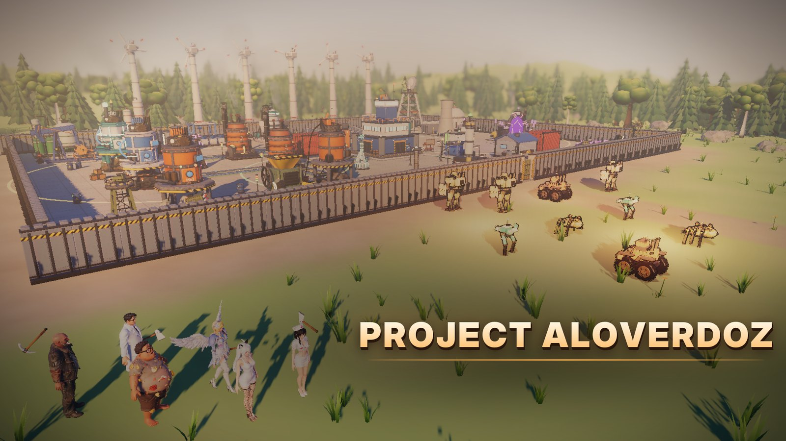
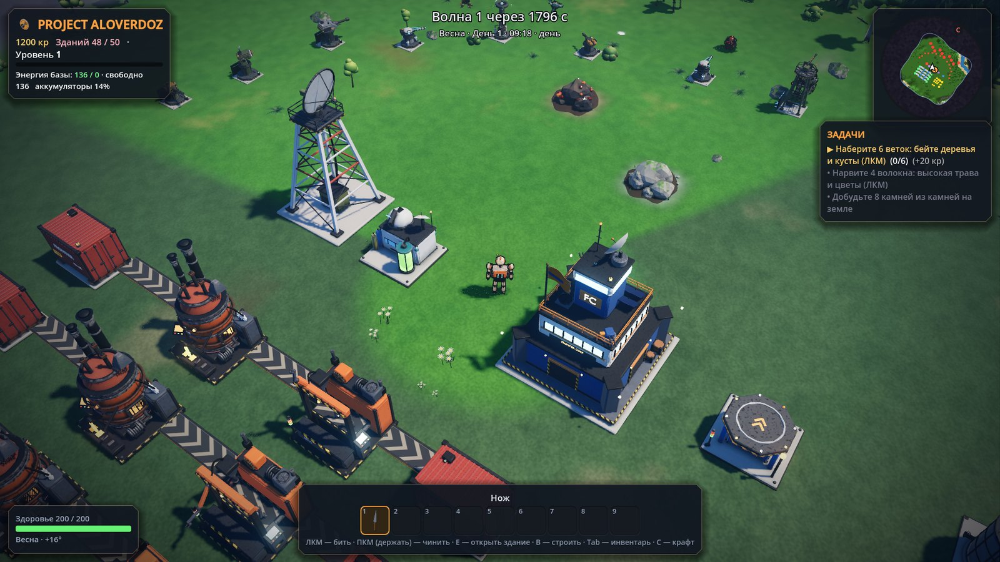
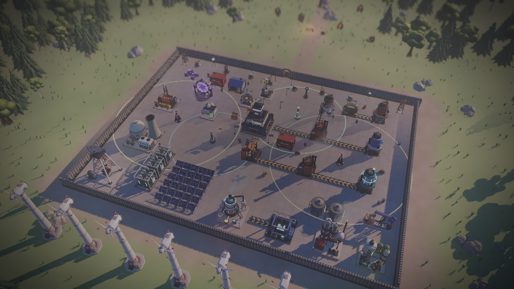
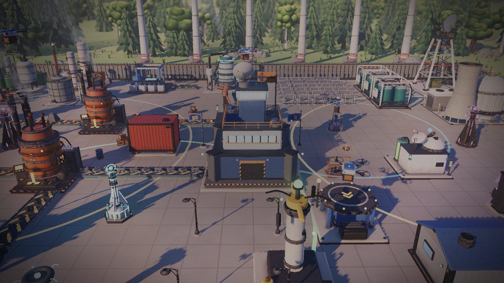
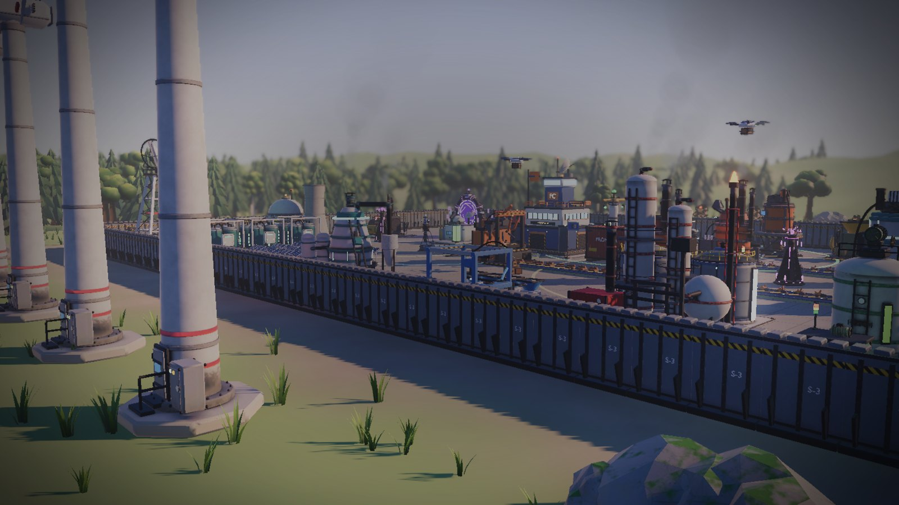
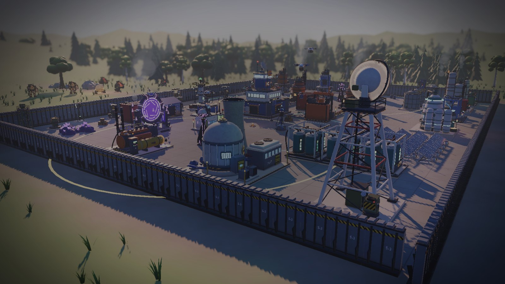
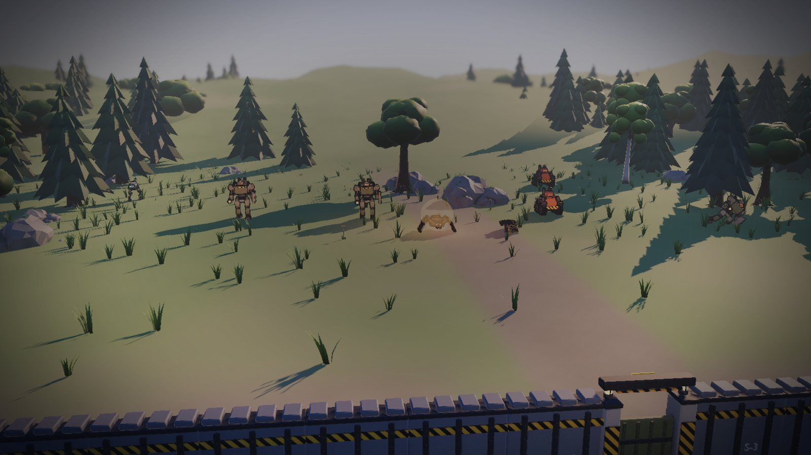
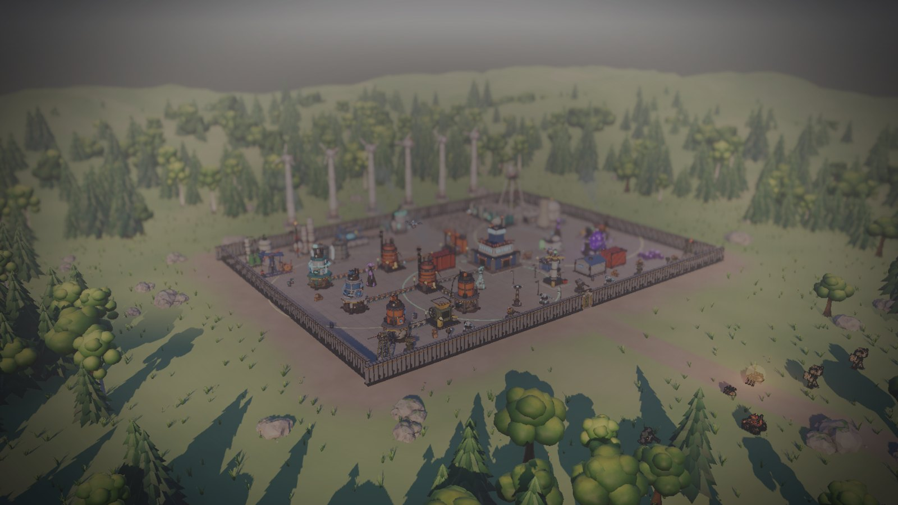

<div align="center">



# PROJECT ALOVERDOZ

**Строй. Автоматизируй. Защищай.**

Фабрика, выживание и оборона базы на чужой планете: в одиночку, с друзьями по сети или вдвоём за одним экраном.


[Об игре](#об-игре) · [Скриншоты](#скриншоты) · [Возможности](#возможности) · [Запуск](#запуск-из-исходников) · [Сервер](#выделенный-сервер) · [English](#english)

</div>

---

## Об игре

Корпорация высадила вас на дикую планету с ножом и штабом. Сначала вы собираете ветки и камни и делаете первую кирку. Потом ставите буры, печи, ленты и генераторы. Скоро у вас целый завод, который сам добывает, плавит и собирает. Каждую ночь к стенам подходят всё новые роботы-мехи, так что завод придётся защищать турелями, щитами и стенами.

Игра сделана на **Godot 4.3** целиком на GDScript. Модели, звуки и музыка создаются процедурно или в Blender, внешних ассетов почти нет.

## Скриншоты

<p align="center">
  
  <br><em>Штаб, линии плавки и сборки, радар и лаборатория. Интерфейс задач и мини-карта.</em>
</p>

<table>
  <tr>
    <td width="50%"><br><em>Вся база за стеной: энергетика, заводы, склады</em></td>
    <td width="50%"><br><em>Сердце базы: штаб, дроны и посадочная площадка</em></td>
  </tr>
  <tr>
    <td width="50%"><br><em>Ветряки, нефтехимия и тяжёлая промышленность</em></td>
    <td width="50%"><br><em>Стена с радаром на углу: впереди ночь и волна</em></td>
  </tr>
  <tr>
    <td width="50%"><br><em>Волна мехов идёт на стену</em></td>
    <td width="50%"><br><em>Колония посреди леса</em></td>
  </tr>
</table>

## Возможности

### 🏭 Фабрика
- **170 зданий, 230 предметов, 219 рецептов.** Буры, печи, сборщики, нефтехимия, атомная и квантовая энергетика.
- **Ленты** с разделителями, слияниями, лифтами и мостами, плюс **трубы** для жидкостей.
- **Уровни Mk1–Mk5**, ползунок мощности для каждой машины, карта потоков, которая подсвечивает узкие места.
- **Объединение зданий.** Две одинаковые машины рядом сливаются в одну, более сильную. Разные можно собрать в составное здание: бур, печь, ящик и генератор работают как одно целое.
- **Энергия:** провода или станции с радиусом действия, аккумуляторы, ветер, солнце, уголь, нефть, атом.
- **Дроны:** грузовые маршруты, сбор вещей с земли, станции отправки и приёма.

### 🛡️ Выживание и оборона
- Ночью приходят волны роботов, бывают осады с боссами и натиск.
- Турели с патронами и энергией, щиты, стены и ворота, мины, прожекторы.
- События мира: кислотный дождь, буря, метеоры, солнечный выброс, заражение.
- Подземелья с редкими чертежами, голод, климат и времена года.

### 🧑‍🚀 Герой
- Ручная добыча и крафт: ветки, волокно, камень, первая кирка, верстак.
- Прочность инструментов, свежесть еды, навыки, характеристики и профессии.
- Двадцать героев на выбор, все со скелетной анимацией.
- Пошаговое обучение на 28 шагов, по одному действию за шаг.

### 🌐 Вместе
- **Кооператив по сети.** Хост и гости, поиск комнат через интернет, код комнаты, UPnP и пробивка NAT.
- Правила комнаты: общая база или своя у каждого, права на чужие постройки, отдельные кошельки, рынок игроков, подарки.
- **Выделенный сервер** для Linux и Windows. Админ-панель прямо в игре: миры, игроки, правила, бэкапы, автоперезапуск.
- **Сплитскрин** на одном компьютере и полная поддержка геймпада.

### 🎮 Режимы
- **Выживание:** классика с героем.
- **Стратегия:** вид сверху без героя, только стройка и управление.
- Заготовки правил от «Мирного» до «Безумия» и включение или выключение каждого модуля игры.

### 🛠️ Для мододелов
- **Редактор** (FrontierEditor): все данные игры, конструктор моделей, карта, процедурный синтезатор звуков и раскладка интерфейса.
- Моды и сборки собственных игр на том же движке, правила-блоки без кода.
- Все данные лежат в `core/*.json` и генерируются скриптами `tools/*.py`.

### 🚀 Выпуск
- **Лаунчер** с дельта-обновлениями: качаются только изменённые куски.
- Набор для Steam: достижения, облачные сохранения, тексты магазина.
- Русский и английский язык.

## Запуск из исходников

Понадобится [Godot 4.3](https://godotengine.org/download/archive/4.3-stable/) (стандартная сборка, не .NET).

```bash
git clone <адрес-репозитория>
cd <папка-репозитория>
godot --path . --editor     # открыть проект в редакторе Godot
godot --path .              # или сразу запустить игру
```

При первом открытии Godot сам импортирует модели и текстуры, это займёт несколько минут.

### Тесты

В проекте больше 140 автотестов: механики, сеть, сохранения, сервер.

```bash
bash tools/test_all.sh              # все тесты по очереди
P=4 bash tools/test_par.sh          # параллельно в 4 потока
godot --headless --path . -- --test=chest120_115   # один тест
```

### Сборка

```bash
bash tools/build15.sh 1.1.20        # игра, демо, редактор, серверы, лаунчер, исходники
```

Нужны шаблоны экспорта Godot 4.3, `mono` (лаунчер), `node` (иконка exe) и `zip`.

## Выделенный сервер

```bash
# на сервере Linux (Ubuntu/Debian)
bash install_server.sh              # ставит сервер как службу и запускает
```

Сервер виден в списке комнат. Управлять им можно из игры: меню → «Сервер» → админ-панель.

## Структура проекта

| Папка | Что внутри |
|---|---|
| `scripts/` | Весь код игры: `main.gd`, `factory.gd` (здания и ленты), `net.gd` (сеть), `fusion.gd` (объединение), `hud.gd` (интерфейс) и др. |
| `core/` | Данные: здания, предметы, рецепты, враги, дерево открытий, обучение |
| `tools/` | Генераторы данных, тесты, сборка, лаунчер, перевод |
| `models20/` | Модели Blender, запечённые для Godot |
| `scenes/`, `shaders/`, `ui/`, `sounds/` | Сцены, шейдеры, интерфейс, звуки |

## English

**PROJECT ALOVERDOZ** is a factory-building survival game made in **Godot 4.3** (GDScript only). You land on an alien planet with a knife and an HQ. You gather, craft and automate: 170 buildings, belts, pipes, power grids, drones, and machines that fuse into stronger composites. Every night robot waves attack the walls. Play solo, online co-op (dedicated server with an in-game admin panel), or split-screen with a gamepad. A full modding editor, a delta-update launcher and Russian/English localisation are included.

---

<div align="center">

© Project Aloverdoz. Все права защищены.

</div>
